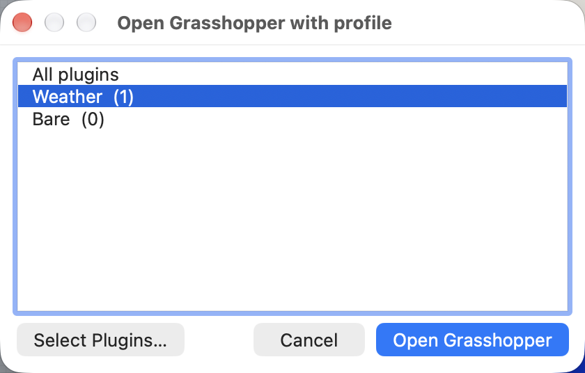
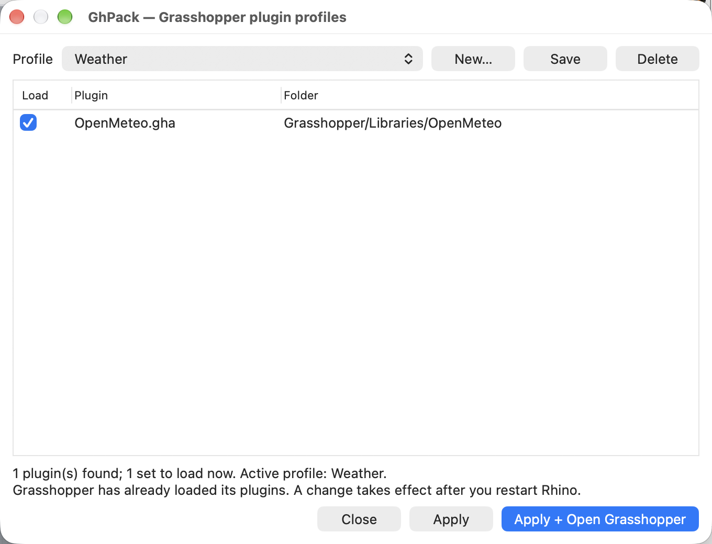

# GhPack

Profiles ("modpacks") for Grasshopper plugins. Pick a group of plugins, then open Grasshopper with
only that group loaded. Fewer plugins means a faster Grasshopper start and a shorter component ribbon.

GhPack is a Rhino plugin (`.rhp`). It has to be: a Grasshopper plugin loads *with* Grasshopper, which
is too late to decide what Grasshopper loads.

| Open Grasshopper with a profile | Select the plugins in a profile |
|---|---|
|  |  |

## Use

1. Click the GhPack toolbar button (green stacked plates), or run `GhPackLaunch`.
2. Pick a profile and click **Open Grasshopper**.
3. To change what a profile loads, click **Select Plugins…**, tick the plugins, and **Save**.

Use `GhPackLaunch` instead of the `Grasshopper` command. Grasshopper cannot unload a plugin, so if it
has already loaded its plugins in this Rhino session, a profile change takes effect after you restart
Rhino. GhPack tells you when that is the case.

| Command | What it does |
|---|---|
| `GhPackLaunch` | Profile picker, then opens Grasshopper. |
| `GhPack` | Profile editor. |
| `-GhPackLaunch <profile>` | Scripted: apply a profile and open Grasshopper. |
| `-GhPack <profile>` | Scripted: apply a profile only. |

The profile name `All` loads every plugin.

## Install

Download `ghpack-<version>-rh8_0-any.yak` from the [Releases](https://github.com/Ethan-Otto/GhPack/releases) page.
A `.yak` file is a zip archive. Unzip it into a new folder named after the version inside Rhino's
package folder, and put the version number in a `manifest.txt` beside that folder:

```
<packages>/GhPack/manifest.txt        <- contains the text: 0.1.0
<packages>/GhPack/0.1.0/GhPack.rhp
<packages>/GhPack/0.1.0/GhPack.Core.dll
<packages>/GhPack/0.1.0/GhPack.rui
```

`<packages>` is:

- macOS: `~/Library/Application Support/McNeel/Rhinoceros/packages/9.0` (or `8.0`)
- Windows: `%APPDATA%\McNeel\Rhinoceros\packages\9.0` (or `8.0`)

Restart Rhino. The toolbar button appears, and the `GhPack` commands are available.

## How it works

GhPack uses Grasshopper's own ignore mechanism, the one behind the `GrasshopperIgnorePlugin` command.
Grasshopper skips `Foo.gha` when a file named `Foo.no9` (Rhino 9; `Foo.no8` on Rhino 8) sits beside
it. Applying a profile writes that marker for each plugin the profile leaves out and deletes it for
each plugin the profile includes.

- GhPack never moves, renames, or edits a `.gha` file.
- To undo everything, apply the `All` profile, or delete the `.no9` files.
- Profiles are stored in `profiles.json` in `~/Library/Application Support/GhPack/` (macOS) or
  `%APPDATA%\GhPack\` (Windows). A profile is a name and a list of `.gha` file names, so the file can
  be copied to another machine.

```json
{
  "activeProfile": "Structural",
  "profiles": [
    { "name": "Structural", "enabled": ["Karamba.gha", "Kangaroo.gha"] }
  ],
  "extraFolders": []
}
```

GhPack finds plugins in the folders Grasshopper scans: the `Libraries` folder, folders named in
`.ghlink` files, installed package folders, and folders added in `GrasshopperDeveloperSettings`.
Add any other folder to `extraFolders`.

## Limits

- Tested on Rhino 9.1 on macOS only. It is built to run on Rhino 8 and on Windows (a single
  `net7.0` build, no platform-specific code paths beyond folder locations), but those are untested.
- The components built into Grasshopper are not managed. GhPack does not write into the Rhino install.
- Grasshopper plugins that install as an `.rhp`, and plugins shipped as a `.gha` *folder*, are not
  covered: Grasshopper does not check the marker file for them.
- A profile identifies a plugin by file name. Two plugins with the same file name in different
  folders are switched together.

## Build

Needs the .NET 10 SDK. RhinoCommon comes from NuGet, so Rhino is not needed to compile.

```sh
dotnet build src/GhPack -c Release   # the plugin: src/GhPack/bin/Release/net7.0/GhPack.rhp
dotnet test tests/GhPack.Tests       # unit tests
./build-package.sh                   # dist/ghpack-<version>-rh8_0-any.yak (needs the yak CLI from Rhino)
```

Layout:

- `src/GhPack.Core`: plugin scan, profiles, and apply logic. No Rhino dependency; unit tested.
- `src/GhPack`: the Rhino plugin: commands, Eto dialogs, and `GhPack.rui` (the toolbar button).
- `package`: yak manifest and icon.

## License

MIT. See [LICENSE](LICENSE).
